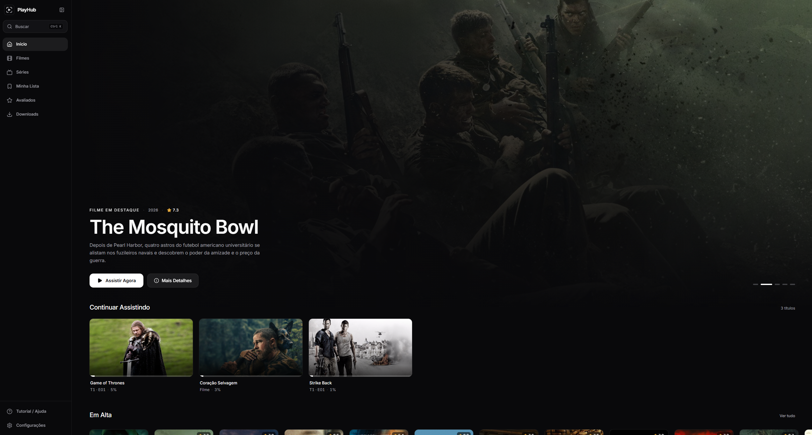
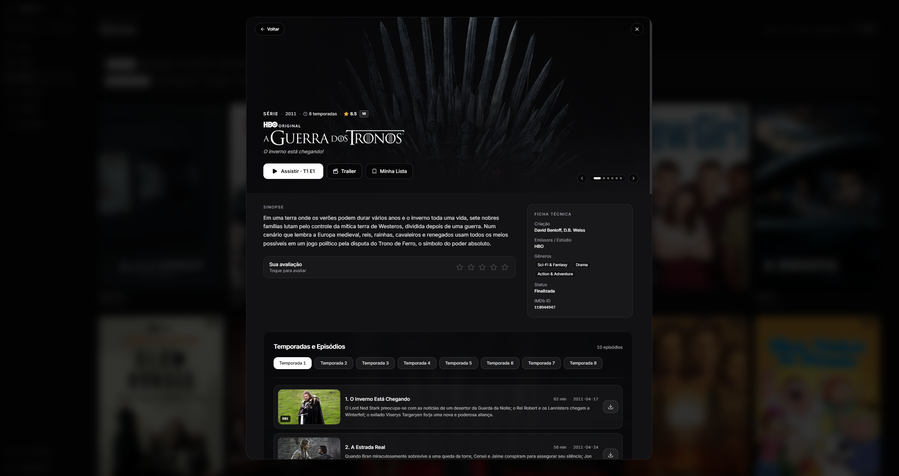
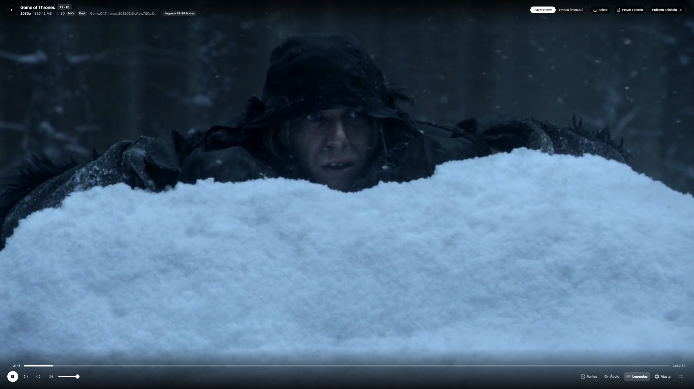

<div align="center">


# PlayHub

**Catálogo limpo, reprodução instantânea e experiência de cinema no seu PC.**

[](https://github.com/Luanserph/playhub/releases/latest)
[](https://github.com/Luanserph/playhub/releases/latest)
[](#para-desenvolvedores)
[](#roadmap)

<br />

**[Baixar instalador para Windows (`.exe`)](https://github.com/Luanserph/playhub/releases/latest)** &nbsp;·&nbsp; [Prévia](#prévia) &nbsp;·&nbsp; [O que ele faz](#o-que-o-playhub-entrega) &nbsp;·&nbsp; [Atalhos](#atalhos-do-teclado) &nbsp;·&nbsp; [Rodar localmente](#para-desenvolvedores)

</div>

---

> **Projeto em evolução constante:** o PlayHub nasceu para unir a praticidade de abrir um filme ou série em segundos com uma interface limpa — sem anúncios, sem poluição visual e sem precisar configurar terminal. Novas versões, melhorias no player e ajustes de interface chegam com frequência.

## Prévia

<p align="center">
  
</p>

<table width="100%">
  <tr>
    <td width="50%" align="center">
      
      <sub>Detalhes em tela cheia e barra de temporadas temática</sub>
    </td>
    <td width="50%" align="center">
      
      <sub>Player nativo com proporção customizável e legendas PT-BR</sub>
    </td>
  </tr>
</table>

---

## Instalação rápida no Windows

Nada de instalar Node.js, configurar FFmpeg ou abrir linha de comando. O instalador já embute tudo e roda sem pedir senha de administrador.

1. Acesse a aba **[Releases](https://github.com/Luanserph/playhub/releases/latest)** e baixe o arquivo **`PlayHub_0.2.0_x64-setup.exe`**.
2. Execute o instalador e abra o **PlayHub** pelo menu Iniciar.
3. Na primeira abertura, o guia inicial pede apenas sua **chave gratuita da API do TMDB** — cole, clique em **Testar e Salvar** e o catálogo carrega na hora.

---

## O que o PlayHub entrega

<table>
  <tr>
    <td width="50%" valign="top">
      <h3>Catálogo editorial & descoberta</h3>
      <ul>
        <li><strong>Visual limpo:</strong> inspirado em Apple TV+ e MUBI, com <strong>Ambilight sutil</strong> nos cards e trilho <em>Continuar Assistindo</em> em widescreen (16:9).</li>
        <li><strong>Detalhes em tela cheia:</strong> slideshow de banners oficiais, elenco, ficha técnica, títulos semelhantes e barra de temporadas com fundo temático legível.</li>
        <li><strong>Busca Spotlight (<kbd>Ctrl</kbd> + <kbd>K</kbd>):</strong> encontre por nome ou cole direto um link/ID do IMDb (ex: <code>tt0371746</code>).</li>
        <li><strong>Imune a bloqueios de rede:</strong> proxy e cache local para dados e imagens do TMDB.</li>
      </ul>
    </td>
    <td width="50%" valign="top">
      <h3>Player Nativo + Modo Híbrido</h3>
      <ul>
        <li><strong>Reprodução P2P local:</strong> motor próprio com remux/transcode via FFmpeg (com aceleração NVENC quando disponível) e avanço rápido na barra de tempo.</li>
        <li><strong>Proporção de tela sob medida:</strong> alterne entre <em>Ajustar</em>, <em>Preencher</em>, <em>Esticar</em>, <code>16:9</code>, <code>4:3</code> e <code>21:9</code> direto no player.</li>
        <li><strong>Modo Embed (<code>imdb.su</code>):</strong> alterne com 1 clique quando quiser começar na hora sem esperar peers.</li>
        <li><strong>Up Next & Player Externo:</strong> pula para o próximo episódio automaticamente e permite abrir o stream bruto direto no <strong>VLC / MPV</strong> (<code>.m3u</code>).</li>
      </ul>
    </td>
  </tr>
  <tr>
    <td width="50%" valign="top">
      <h3>Legendas PT-BR de verdade</h3>
      <ul>
        <li><strong>Busca em 3 camadas:</strong> extrai faixas embutidas no próprio MKV/MP4 e pesquisa em paralelo no <strong>OpenSubtitles</strong> e <strong>Wyzie Subs</strong>.</li>
        <li><strong><code>PT-BR</code> separado de <code>PT-PT</code>:</strong> prioriza português brasileiro real e traduz automaticamente por IA quando só houver legenda em outro idioma.</li>
        <li><strong>Controle total:</strong> arraste seu próprio <code>.srt</code>, <code>.vtt</code> ou <code>.ass</code> para o player, ajuste tamanho (<code>P</code>/<code>M</code>/<code>G</code>) e sincronia em tempo real.</li>
        <li><strong>Dublagem Neural (experimental):</strong> síntese de voz via Edge-TTS com redução suave do áudio original.</li>
      </ul>
    </td>
    <td width="50%" valign="top">
      <h3>Add-ons, Downloads & Modo Offline</h3>
      <ul>
        <li><strong>Catálogo de Add-ons integrado:</strong> instale com 1 clique <strong>Torrentio</strong>, <strong>Comet</strong>, <strong>MediaFusion</strong>, <strong>Brazuca Torrents</strong>, <strong>Peerflix</strong> e <strong>OpenSubtitles v3</strong> (ou cole links <code>stremio://</code>).</li>
        <li><strong>Biblioteca Offline:</strong> baixe filmes e episódios em segundo plano (com pausa e retomada real) direto para <code>Downloads\PlayHub</code>.</li>
        <li><strong>Legenda pronta no disco:</strong> o arquivo <code>.pt-br.srt</code> é salvo junto com o vídeo automaticamente para assistir sem internet.</li>
        <li><strong>Backup simples:</strong> exporte e importe histórico, listas, preferências e add-ons em um único JSON.</li>
      </ul>
    </td>
  </tr>
</table>

---

## Atalhos do teclado

| Atalho | Ação |
| :---: | :--- |
| <kbd>Ctrl</kbd> + <kbd>K</kbd> | Abrir busca rápida (Spotlight / ID do IMDb) |
| <kbd>Espaço</kbd> ou <kbd>K</kbd> | Pausar ou retomar |
| <kbd>←</kbd> / <kbd>→</kbd> | Voltar ou avançar 10 segundos |
| <kbd>A</kbd> | Alternar proporção de tela (*Aspect Ratio*) |
| <kbd>C</kbd> | Ligar ou desligar legendas |
| <kbd>G</kbd> / <kbd>H</kbd> | Ajustar atraso da legenda (`-0.5s` / `+0.5s`) |
| <kbd>M</kbd> | Silenciar ou ativar som |
| <kbd>F</kbd> | Entrar ou sair da tela cheia |
| <kbd>Esc</kbd> | Fechar menus ou sair do player |

---

## Roadmap

- [x] **Instalador Windows Tudo-em-Um (v0.2.0):** empacotamento nativo via Tauri v2 com servidor local, FFmpeg e FFprobe embutidos.
- [x] **Downloads e Biblioteca Offline:** gerenciador em segundo plano com legenda `PT-BR` automática.
- [x] **Catálogo de Add-ons nativo:** ativação em 1 clique dos principais provedores comunitários.
- [ ] **Atualizações automáticas no desktop:** aviso e update direto dentro do aplicativo.
- [ ] **Versão Android (APK):** experiência dedicada para celular, tablet e transmissão na TV.
- [ ] **Mais fontes e refinamentos:** melhorias contínuas na detecção de faixas de áudio/legenda e polimento da interface.

---

## Para desenvolvedores

<details>
<summary><strong>Por baixo dos panos (Arquitetura)</strong></summary>

<br />

- **Frontend:** React, TypeScript, Vite, Tailwind CSS e Framer Motion.
- **Desktop:** Tauri v2 (Rust) com inicialização e encerramento automático dos processos em segundo plano, gravando configurações em `%APPDATA%\PlayHub`.
- **Backend Sidecar:** servidor Fastify (`server/`) compilado em executável único via **Node.js SEA (Single Executable Application)** + `esbuild` + `postject`, acompanhado pelos binários de `ffmpeg` e `ffprobe`.
- **Build & Release:** pipeline automatizado no **GitHub Actions** gerando o instalador NSIS `.exe` a cada tag `v*`.

</details>

### Rodando em modo de desenvolvimento

Pré-requisitos: **Node.js 22+** (e `ffmpeg`/`ffprobe` no `PATH` para remux de MKV e extração de legendas embutidas).

```bash
# 1. Instale as dependências do frontend e do backend
npm install
npm --prefix server install

# 2. Suba o servidor local ([http://127.0.0.1:3001](http://127.0.0.1:3001))
npm --prefix server run dev

# 3. Em outro terminal, inicie a interface web (http://localhost:5173)
npm run dev
```

*(Não é preciso configurar `.env` manualmente — a chave do TMDB é informada pela própria interface na primeira execução.)*

---

<div align="center">
  <sub>Feito para quem gosta de cinema em casa sem complicação. Sugestões, ideias e relatos de bugs são sempre bem-vindos.</sub>
</div>